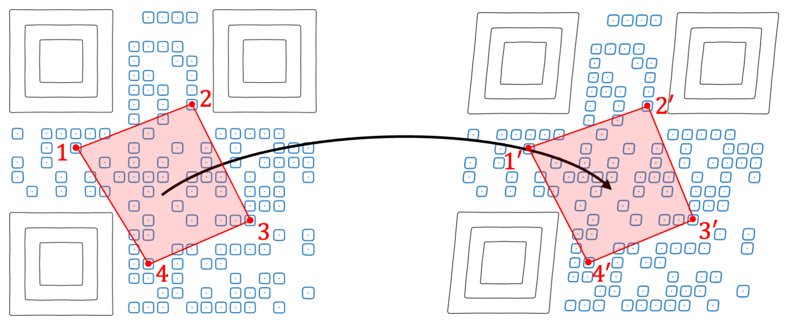
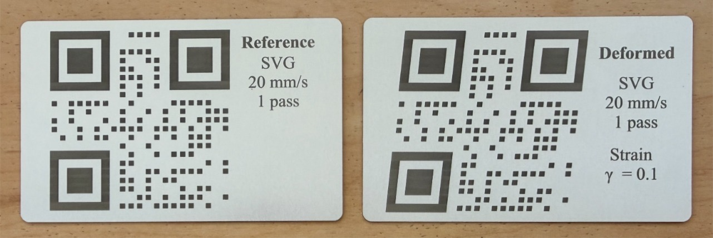
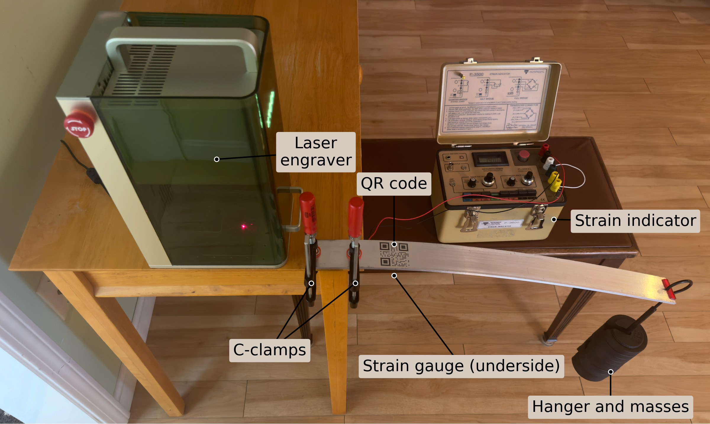
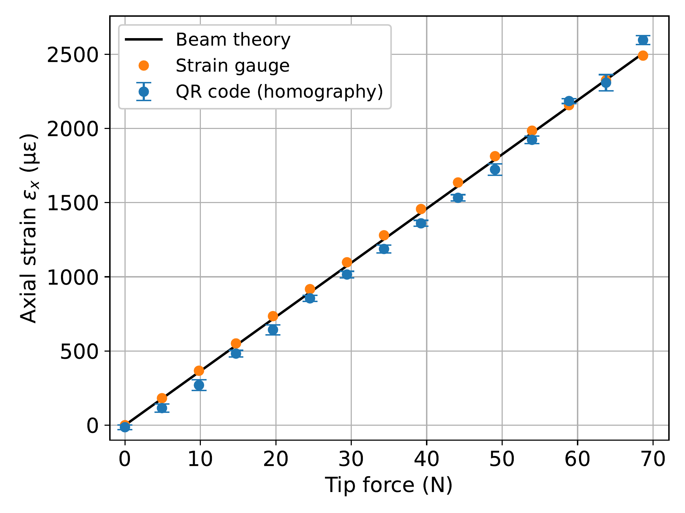

# Rapid Strain Measurement of Civil Infrastructure from Smartphone Images of QR Codes Using Homography

**Surya S. Vel**  
John Bapst Memorial High School, Bangor, Maine

This repository contains the code and research paper for this project.

## Overview
Aging bridges and buildings are a growing safety problem, and structures are still checked mainly by visual inspection, which cannot measure strain. Strain gauges and Digital Image Correlation systems can measure strain, but they are difficult to use on every structural member. This project presents a fast, low-cost way to measure strain from smartphone images of a QR code laser-engraved onto a structural member. A reference image of the code is taken first, and each later image is compared with it. The data modules of the code are detected using a threshold that reduces the effect of shadows and reflections, a correction for camera tilt accounts for a change in viewing angle, and the strain is calculated from homographies between groups of module centers. The method measures both normal and shear strains without wiring or a power source. It achieves sub-pixel accuracy, with an average error of about 3 micrometers in length change across the 48 mm code.

Four module centers, one from each quadrant of the code, form a quadrilateral in the
reference image (left). The same four centers in the deformed image (right) are related to
it by a homography, from which the strain is calculated. This is repeated for 2000 randomly
selected quadrilaterals, and the strains are averaged.

The method was tested on aluminum coupons laser-engraved with QR codes carrying known
normal and shear strains of up to 100 000 microstrain.

In a cantilever beam test, the strains from the QR code differed from beam theory by
61 microstrain on average, compared with 16 microstrain for a strain gauge.

## Contents
- [Research paper](Surya_Vel_Research_Paper.pdf): The paper describes the proposed method, the tests on laser-engraved aluminum coupons, the cantilever beam test and the prototype mobile application.
- [Project Code](Project%20Code/): Python code for strain measurement, the QR code generator, and the prototype mobile application (Flutter frontend and Python backend)

## Status
The code in this repository is being updated to the version described in the paper.

## License
This project is released under the MIT License. See [LICENSE](LICENSE) for details.

