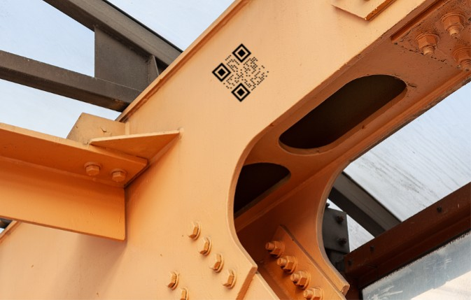

# Rapid Strain Measurement of Civil Infrastructure from Smartphone Images of QR Codes Using Homography

**Surya S. Vel**  
John Bapst Memorial High School, Bangor, Maine

This repository contains the code and research paper for this project.

## Overview
This project measures strain in structural members from smartphone photos of a QR code
laser-engraved on the surface. A reference image of the code is taken first, and each later
image is compared with it. The data modules of the code are detected using a threshold that
reduces the effect of shadows and reflections, a correction for camera tilt accounts for
changes in viewing angle, and the strain is calculated from homographies between groups of
module centers. The method measures both normal and shear strains and needs no wiring or
power source.

In a cantilever beam test, the strains from the QR code differed from beam theory by
61 microstrain on average, compared with 16 microstrain for a strain gauge.

## Contents
- `Surya_Vel_Research_Paper.pdf`: the research paper
- `Project Code/`: Python code for strain measurement, the QR code generator, and the
  prototype mobile application (Flutter frontend and Python backend)

## Status
The code in this repository is being updated to the version described in the paper.

## License
This project is released under the MIT License. See `LICENSE` for details.
